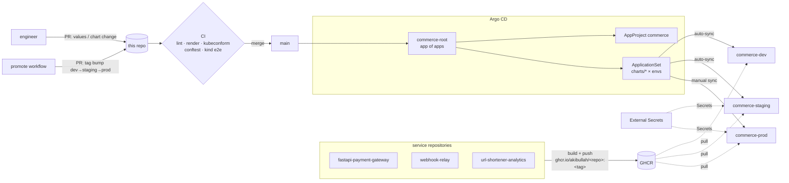

<!-- topics: kubernetes,helm,gitops,argocd,applicationset,kustomize,opa,conftest,rego,kind,devops,platform-engineering -->
# k8s-gitops-platform

GitOps delivery for three of my services (a payment gateway, a webhook relay and a URL shortener): a reusable Helm library chart, per-environment values, Argo CD ApplicationSets, OPA/Rego policies with unit tests, and a CI pipeline that validates every render and deploys the real images to a kind cluster.

[](https://github.com/AkibUllah/k8s-gitops-platform/actions/workflows/ci.yml)


## Why this exists

Each of these services started life with a `docker-compose.yml`, which is fine until there are three of them, three environments and more than one person deploying. The questions then are the boring, important ones: is staging actually shaped like prod, who changed the replica count, why does the payment service run as root, which version is in prod right now. This repo answers them the GitOps way. Git holds the desired state, Argo CD makes the clusters match it, and CI refuses any change that renders invalid manifests or breaks a security rule, before it can be merged.

## Features

- **Helm library chart** (`platform-lib`) with every workload object a service needs: Deployment, Service, Ingress, HPA (autoscaling/v2 with scale-down damping), PDB, ServiceMonitor, NetworkPolicy, ServiceAccount, ConfigMap/Secret wiring, probes and a `helm test` hook
- **Secure by default**: non-root UID, read-only root filesystem with a size-limited `/tmp`, `allowPrivilegeEscalation: false`, all capabilities dropped, RuntimeDefault seccomp, no service-account token; passes the `restricted` Pod Security Standard (enforced in the e2e namespace)
- **Three app charts** that are 3-line templates plus values: `payment-gateway`, `webhook-relay` (API and a separate delivery-worker Deployment from one chart) and `url-shortener` (with Redis)
- **Demo datastores**: PostgreSQL StatefulSet and Redis Deployment that obey the same security rules and are reachable only from their own release; staging and prod use managed services via `existingSecret`
- **Environments**: `dev`, `staging`, `prod` values with image pins, HPA/PDB, zone spreading, TLS, egress allow-lists; `values.schema.json` per chart rejects bad values before rendering
- **Argo CD**: app-of-apps bootstrap, an `AppProject` with namespace/resource guard rails, RBAC roles and a Friday-evening prod sync window (Asia/Dhaka), and a matrix `ApplicationSet` (charts × environments) with auto-sync for dev/staging and manual prod
- **Policies as code**: 20 Rego rules for single manifests and 5 cross-document rules for whole releases (PDB coverage, HPA targets, dangling Ingress backends, orphan Services), with 39 unit tests and an explicit, reasoned exemption mechanism
- **Kustomize overlay** for an on-prem Dhaka site that consumes the Helm output and patches placement, registry mirror and Redis endpoint
- **Secrets guide** for External Secrets Operator and Sealed Secrets, with validated example manifests, and a policy that blocks plain Secrets in staging/prod renders
- **CI**: `helm lint --strict`, render of every chart × environment, kubeconform against Kubernetes 1.34 and 1.36 plus CRD schemas, conftest, negative checks, and a kind e2e job; a `workflow_dispatch` promotion workflow opens tag-bump PRs

## Architecture



Design notes:

- **One library, thin app charts.** Security context, probes, NetworkPolicy and PDB logic exist once in `platform-lib`. An app chart is `{{ include "platform-lib.app" . }}` plus values, so a hardening change lands in all services through one reviewed diff, and Chart.lock pins which library version each service uses.
- **Policy runs on the rendered output, not the templates.** Whatever reaches the cluster (Helm, Kustomize, a hand-written manifest) passes the same Rego rules in CI. The library also refuses `latest` at render time, so the guard holds even where conftest is not in the loop.
- **Promotion is a values diff.** Environments differ only in `environments/<env>/<chart>.yaml`; promoting means copying an image tag in a PR. Staging and prod are rendered from the same chart version, so "works in staging" says something about prod.
- **Sub-components inherit explicitly.** The webhook-relay worker reuses the API's image, env and security settings through a named allow-list of keys, and the chart flips `WORKER_ENABLED` on the API depending on whether the worker Deployment exists, so the delivery loop never runs twice or not at all.
- **Liveness is not readiness.** The URL shortener's `/health` checks PostgreSQL and Redis, so it drives readiness only; liveness is a TCP check. A datastore outage drains traffic instead of restarting every pod at once.

## Tech Stack

| Concern | Choice |
| --- | --- |
| Packaging | Helm 3.22 (library + application charts, JSON Schema for values) |
| Delivery | Argo CD: Application (app of apps), AppProject, ApplicationSet (matrix: git directories × list) |
| Overlays | Kustomize 5 (`helmCharts` inflation + strategic/JSON patches) |
| Validation | kubeconform 0.8 (Kubernetes 1.34.11, 1.36.4 + datreeio CRD catalog) |
| Policy | conftest 0.71 / OPA Rego v1, unit tests with `conftest verify` |
| E2E | kind 0.33, Kubernetes 1.36.4, 3 nodes, Pod Security `restricted` |
| Secrets | External Secrets Operator or Sealed Secrets (documented, examples validated) |
| CI | GitHub Actions, pinned + checksum-verified tool installer |

## Quick Start

### Validate everything (no cluster needed)

```bash
git clone https://github.com/AkibUllah/k8s-gitops-platform.git && cd k8s-gitops-platform
make tools       # helm, kubeconform, conftest, kind, kubectl -> ~/.local/bin (sha256-verified)
make validate    # lint, render, kubeconform x2 versions, policy tests, policies, negative checks
```

### End-to-end on kind

```bash
make e2e         # builds images from the GitHub repos, installs, tests, deletes the cluster
make e2e-local   # same, building from sibling checkouts in ../
make demo-up     # keep the cluster afterwards; `make demo-down` removes it
```

The default cluster has a control plane and two workers. On a small or busy machine use one node: `KIND_CONFIG=e2e/kind-single-node.yaml make e2e-local`. If a service image cannot be built, the script falls back to a stand-in HTTP server for that service and says so, so chart, policy and network wiring are still exercised.

### Bootstrap Argo CD on a real cluster

```bash
kubectl create namespace argocd
kubectl apply -n argocd --server-side -f https://raw.githubusercontent.com/argoproj/argo-cd/stable/manifests/install.yaml
# create the Secrets that staging/prod reference (docs/secrets.md), then:
kubectl apply -n argocd -f argocd/bootstrap/root-app.yaml
```

`commerce-root` syncs `argocd/`, which creates the `commerce` project and the ApplicationSet, which in turn creates nine Applications (`payment-gateway-dev` … `url-shortener-prod`).

### Render one release by hand

```bash
make deps
helm template payment-gateway charts/payment-gateway -n commerce-prod -f environments/prod/payment-gateway.yaml
kubectl kustomize --enable-helm --load-restrictor LoadRestrictionsNone kustomize/overlays/prod-dhaka-dc2
```

## Environments

| | dev | staging | prod |
| --- | --- | --- | --- |
| Namespace | `commerce-dev` | `commerce-staging` | `commerce-prod` |
| Image tags | `main-<sha>` (bumped by service CI) | release candidates | promoted releases |
| Replicas | 1 | HPA 2–4 | HPA 3–12, PDB `minAvailable: 2` |
| Spread | none | hostname | zone + hostname |
| Database / cache | in-chart PostgreSQL / Redis | managed, via `existingSecret` | managed, via `existingSecret` |
| Secrets | sandbox values in Git | External Secrets | External Secrets |
| Ingress | HTTP | TLS (letsencrypt-staging) | TLS (letsencrypt-prod), rate-limit annotations |
| Egress | open | DB subnet + public 443 only | DB subnet + public 443 only |
| Argo CD sync | automated, prune, self-heal | automated, prune, self-heal | manual, deny window Fri 12:00–18:00 |

The service images are referenced as `ghcr.io/akibullah/<repo>:<tag>` (`fastapi-payment-gateway`, `webhook-relay`, `url-shortener-analytics`), built from each repository's own Dockerfile.

## Policies

`policies/kubernetes` runs per document (`conftest test`), `policies/combined` over a whole release (`conftest test --combine --namespace combined`).

| Rule | Why |
| --- | --- |
| Image must have a version tag or digest, never `latest` (registry ports handled) | reproducible rollbacks |
| `requests.cpu`, `requests.memory`, `limits.memory` required (CPU limits deliberately not) | scheduling and OOM safety without CFS throttling |
| `runAsNonRoot`, UID ≠ 0, no privilege escalation, read-only root FS, drop `ALL`, not privileged, RuntimeDefault/Localhost seccomp | container breakout surface |
| No `hostNetwork` / `hostPID` / `hostIPC` / `hostPath` | node isolation |
| Readiness and liveness probes on long-running workloads, unless annotated `policy.akibullah.dev/probes-exempt: <reason>` (reported as a warning) | safe rollouts; exceptions are visible and justified |
| Recommended labels on pod templates | ownership, selectors, cost reports |
| No `NodePort` / `LoadBalancer` without an explicit annotation | all traffic through the ingress controller |
| staging/prod Ingress hosts must be covered by TLS; no `nip.io` hosts there | |
| No plain `Secret` rendered for staging/prod | secrets come from External Secrets / Sealed Secrets |
| prod Deployments with a fixed replica count need ≥ 2 | |
| *combined:* multi-replica staging/prod Deployments need a matching PDB | node drains |
| *combined:* HPA target exists; an HPA-managed Deployment sets no `spec.replicas` | no sync fights |
| *combined:* Ingress backends and Service selectors resolve within the release | dangling routes |

## Repository Layout

```
charts/
├── platform-lib/          # library chart: _workload, _networking, _scaling, _datastores, _app
├── payment-gateway/       # values.yaml, values.schema.json, ci/ (feature-complete test values)
├── webhook-relay/         # + worker component
└── url-shortener/         # + Redis
environments/{dev,staging,prod}/<chart>.yaml
argocd/
├── bootstrap/root-app.yaml        # app of apps, applied once
├── projects/commerce.yaml         # AppProject: repos, namespaces, RBAC, sync windows
└── apps/commerce-services.yaml    # ApplicationSet: charts/* × environments
kustomize/base, kustomize/overlays/prod-dhaka-dc2
policies/kubernetes/*.rego, policies/combined/*.rego (+ *_test.rego, fixtures/)
docs/secrets.md, docs/examples/    # ESO ClusterSecretStore / ExternalSecret, SealedSecret
e2e/                               # kind cluster config, e2e and stand-in values
scripts/                           # install-tools, render, validate, e2e-kind
.github/workflows/                 # ci.yml, promote.yml
```

## Testing

```bash
make validate    # what CI's validate job runs
make e2e-local   # kind end to end
```

**Static validation** (`make validate`, also in CI): `helm lint --strict` for 3 charts × 3 environments; 14 rendered releases (9 environment renders, 4 `ci/` feature renders, 1 Kustomize overlay); kubeconform strict against Kubernetes 1.34.11 and 1.36.4 plus CRD schemas: 178 resources valid on both versions, including the Argo CD and External Secrets/Sealed Secrets manifests; `conftest verify`: 39/39 Rego unit tests pass; the per-document policies pass on every release (warnings list the one annotated probe exemption, the webhook-relay worker); cross-document policies pass release by release; negative checks confirm that `image.tag=latest`, an invalid `values.schema.json` input and a deliberately non-compliant manifest are all rejected.

**End to end on kind** (`scripts/e2e-kind.sh`, CI job `e2e`). Last local run, on the default 3-node cluster (Kubernetes 1.36.4) with all three service images built from their Dockerfiles:

- all 8 pods (3 apps, the webhook worker, 3 PostgreSQL, 1 Redis) Running with **0 restarts**, in a namespace that enforces the `restricted` Pod Security Standard, spread across both workers
- `helm test` passes for all three releases; `/health` reports `database: ok` (and `cache: ok` for the shortener)
- URL shortener: `POST /api/v1/links` → 201, `GET /eid-sale` → 302 (PostgreSQL, Redis and secret wiring)
- webhook relay: an event published through the API is picked up and attempted by the separate worker Deployment
- NetworkPolicy: a pod without the platform label times out reaching the payment gateway (kindnet enforces policies)

The local runs also found two real bugs that are now fixed: apps crash-looped until PostgreSQL was ready (now an init container waits for it), and `pg_isready` silently never connects when run as a numeric UID without `-U`.

## Roadmap

- Argo CD Image Updater (or Renovate) writing dev tag bumps back to Git instead of service CI
- Argo Rollouts canaries for the payment gateway, gated on error rate from Prometheus once the services expose metrics
- Kyverno admission policies mirroring the Rego rules, so the guard also holds for `kubectl apply`
- Per-namespace ResourceQuota/LimitRange managed by the platform team's own ApplicationSet
- Chart publishing to an OCI registry with provenance, instead of `file://` dependencies

## License

MIT — see [LICENSE](LICENSE).
